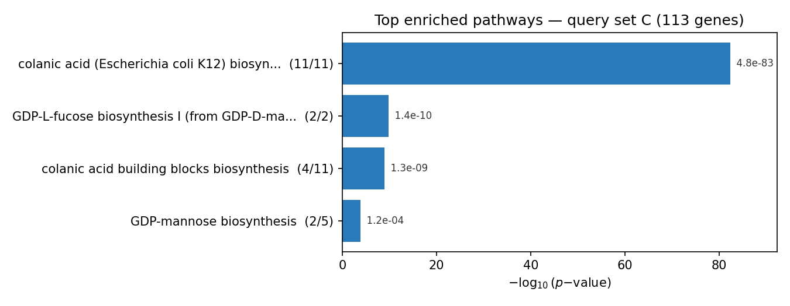

# Analyse d'enrichissement fonctionnel d'E. coli sur un graphe Neo4j

[](https://github.com/boumbo85/ecoli-neo4j-genomics/actions/workflows/tests.yml)

> 🇫🇷 Français · [🇬🇧 English version](./README.md)

Donnez à cet outil une liste de gènes d'*E. coli*, et il vous dit ce qu'ils font ensemble —
quelles voies métaboliques, quelles fonctions GO, quelles familles de protéines, et même quels
articles les décrivent. Tout tourne en requêtes Cypher sur un graphe de connaissances Neo4j,
avec les statistiques faites en Python.

**Contexte :** M2 Bio-informatique (Université Paul Sabatier), module NoSQL / bases de données orientées graphe.
**Organisme :** *Escherichia coli* K-12 MG1655 (`GCF_000005845.2`).

---

## Le problème

Une liste brute de 100 à 200 identifiants de gènes (`b0001 b0002 b0003 …`) ne porte aucun sens
biologique en soi. Ce projet transforme cette liste en une réponse classée par p-value à la
question *« qu'est-ce qui relie ces gènes ? »* — et permet ensuite de remonter le fil jusqu'à
la littérature.

```
liste de gènes  →  graphe Neo4j  →  test d'enrichissement  →  termes classés  →  articles PubMed  →  biologie
```

## Le graphe de connaissances

Un nœud `Gene` central, relié à six couches d'annotation par des relations typées :

```
                         ┌─────────────┐
            annotates    │   GOTerm    │  is_a / part_of
          ┌──────────────│  (GO:xxxx)  │──────────────┐
          │              └─────────────┘              │ (hiérarchie)
          │                                           ▼
   ┌──────────┐  requires   ┌─────────┐        ┌─────────────┐
   │  Pathway │────────────▶│         │        │   GOTerm    │
   │ (EcoCyc) │             │         │        └─────────────┘
   └──────────┘             │         │
                            │  Gene   │  harbors   ┌─────────┐
   ┌──────────┐  encoded_in │ (bNNNN) │◀───────────│   TU    │
   │ InterPro │────────────▶│         │            │(EcoCyc) │
   └──────────┘             │         │            └─────────┘
                            │         │  cites     ┌─────────┐
   ┌──────────┐  annotates  │         │◀───────────│ PubMed  │
   │ Keyword  │────────────▶│         │            │ (NCBI)  │
   │(UniProt) │             └────┬────┘            └─────────┘
   └──────────┘                  │ coexpression (STRING)
                                 ▼
                              (Gene)
```

| Nœud cible  | Relation vers `Gene`             | Source      |
|-------------|----------------------------------|-------------|
| `GOTerm`    | `is_a`, `part_of`, `annotates`   | Gene Ontology (`go-basic.obo`) |
| `Pathway`   | `requires`                       | EcoCyc      |
| `TU` (unité de transcription) | `harbors`      | EcoCyc      |
| `InterPro`  | `encoded_in`                     | UniProt     |
| `Keyword`   | annotates                        | UniProt     |
| `PubMed`    | `cites`                          | NCBI        |
| `Gene`→`Gene` | `coexpression`                 | STRING v12  |

## Les statistiques

Chaque terme candidat est testé pour sa surreprésentation dans le set de requête par rapport au
génome entier (4315 gènes). Quatre mesures, plus une correction FDR optionnelle :

- **Binomial** (par défaut) — calculé sur les échecs pour la stabilité numérique
- **Hypergéométrique** — tirage sans remise
- **Chi²** — test sur table de contingence
- **Coverage** — score de recouvrement simple

---

## Exemple complet — de la liste de gènes à la biologie

En lançant l'outil sur le set de requête **C** (113 gènes) :

```bash
python app.py -q query/set1.txt -t Pathway -c
```

**Voies métaboliques enrichies (EcoCyc) :**

| ID voie    | p-value   | gènes | Description |
|------------|-----------|-------|-------------|
| PWY-8243   | 4.8e-83   | 11/11 | biosynthèse de l'acide colanique (E. coli K12) |
| PWY-66     | 1.4e-10   | 2/2   | biosynthèse du GDP-L-fucose I |
| COLANSYN-PWY | 1.3e-09 | 4/11  | briques de l'acide colanique |



*Générée avec `python plot_enrichment.py <results.tsv> -o fig.png`.*

**Les termes GO enrichis** pointent dans la même direction — processus de biosynthèse de
l'acide colanique (GO:0046377, p = 3.3e-96, 17/23 gènes), plus un second groupe autour de la
**signalisation au c-di-GMP** (diguanylate cyclase GO:0052621, phosphodiestérase GO:0071111) et
de la **régulation négative de la motilité flagellaire** (GO:1902201).

**En remontant jusqu'à la littérature** (`-t PubMed`), on retrouve le PMID **16672475**
(p = 5.2e-279, 35 gènes) — la référence décrivant la synthèse capsulaire de l'acide colanique.

**Alors, qu'est-ce que ça veut dire ?** Le bloc de gènes **b2044–b2059** code la biosynthèse de
l'**acide colanique**, un exopolysaccharide capsulaire. Son apparition aux côtés des enzymes du
c-di-GMP et des répresseurs de motilité raconte une histoire cohérente : ces gènes pilotent le
basculement d'un mode de vie mobile et planctonique vers un **état sessile, formateur de biofilm**
sous stress — l'analyse d'enrichissement reconstitue cette biologie à partir d'une simple liste
d'identifiants anonymes.

---

## Structure du projet

```
.
├── app.py                     # outil principal d'enrichissement (CLI + requêtes Cypher)
├── enrichment.py              # mesures statistiques (fonctions pures, testées)
├── load_graph.cypher          # construit le graphe depuis csv/ (LOAD CSV)
├── load_graph.sh              # copie les CSV + exécute load_graph.cypher
├── docker-compose.yml         # instance Neo4j reproductible
├── tests/                     # tests unitaires des mesures d'enrichissement
├── scripts/
│   ├── GeneOntology.py        # parseur OBO → nœuds GO & arêtes is_a/part_of
│   ├── gbff.to.bed.py         # annotation du génome → BED (coordonnées des gènes)
│   ├── gbff.to.bnumber.GeneID.py  # association bnumber ↔ GeneID NCBI
│   ├── ncbi.py                # association gène ↔ citation PubMed
│   └── proba_binom1.py        # prototype d'enrichissement binomial
├── csv/                       # CSV/TSV prêts à charger (nœuds & arêtes du graphe)
├── query/                     # sets de gènes d'exemple (set1-3, query6)
├── Results/                   # sorties d'enrichissement + tables Revigo
└── course-material/           # TP UniProt / similarité (hors pipeline)
```

### Index des résultats

Les fichiers sont nommés `res_<Type>_<set>.txt`. Chaque ligne est séparée par des tabulations :
`id_terme   p-value   commun/cible   description   gènes`.

| Motif de fichier        | Contenu |
|-------------------------|---------|
| `res_GOTerm_*.txt`      | Termes GO enrichis (BP/MF/CC) par set de gènes |
| `res_Pathway_*.txt`     | Voies EcoCyc enrichies |
| `res_TU_*.txt`          | Unités de transcription enrichies |
| `res_InterPro_*.txt`    | Familles de protéines InterPro enrichies |
| `res_keywords*`         | Mots-clés UniProt enrichis |
| `res_PubMed_*.txt`      | Littérature surreprésentée (PMIDs) |
| `Revigo_BP/MF_*.tsv`    | Regroupement sémantique Revigo des termes GO (pour les graphiques) |

> **Note sur `course-material/`** — `TP01/02/03_*.Rmd` sont des TP UniProt / similarité de
> séquences issus du cours, conservés à titre de référence. Ils ne font pas partie du pipeline.

---

## Démarrage rapide (Docker)

Cloner, lancer Neo4j, construire le graphe, exécuter — quatre commandes :

```bash
docker compose up -d                 # Neo4j sur http://localhost:7474
./load_graph.sh                      # construit le graphe depuis csv/
pip install -r requirements.txt
python app.py -q query/set1.txt -t Pathway -c
```

Identifiants locaux par défaut : `neo4j / testpassword` (voir `docker-compose.yml`).
À remplacer pour tout usage partagé.

## Installation manuelle (Neo4j existant)

Pointez le répertoire d'import de Neo4j vers `csv/`, configurez la connexion, chargez le graphe :

```bash
export NEO4J_URI="bolt://localhost:7687"
export NEO4J_USER="neo4j"
export NEO4J_PASSWORD="votre-mot-de-passe"

NEO4J_IMPORT_DIR=/chemin/vers/neo4j/import ./load_graph.sh
python app.py -q query/set1.txt -t GOTerm -c -v
```

Les identifiants sont lus depuis les variables d'environnement ci-dessus — rien n'est codé en dur.

## Tests

Les mesures statistiques sont dans `enrichment.py` et couvertes par des tests unitaires :

```bash
python -m unittest discover -s tests
```

### Options

| Option | Description | Défaut |
|--------|-------------|--------|
| `-q, --query`   | Set de gènes : un fichier de bnumbers, ou une chaîne entre guillemets | requis |
| `-t, --type`    | Cible : `GOTerm` `Pathway` `TU` `InterPro` `Keyword` `PubMed` | requis |
| `-a, --alpha`   | Seuil de significativité | `0.05` |
| `-c, --adjust`  | Appliquer la correction FDR | off |
| `-m, --measure` | `binomial` `hypergeometric` `chi2` `coverage` | `binomial` |
| `-l, --limit`   | Nombre max de résultats | `0` (tous) |
| `-o, --output`  | Écrire les résultats en TSV dans un fichier | stdout |
| `-v, --verbose` | Afficher les requêtes et les sets | off |

### Visualisation

Transformez n'importe quel fichier de résultats en bar chart des top termes :

```bash
python app.py -q query/set1.txt -t Pathway -c -o pathways.tsv
python plot_enrichment.py pathways.tsv -o fig.png -t "Voies enrichies"
```

## Sources de données

NCBI (`GCF_000005845.2`), EcoCyc, UniProt (protéome `UP000000625`),
Gene Ontology (`go-basic.obo`), STRING v12.

## Feuille de route / prochaines étapes

Ce qui ferait passer ce projet d'un bon travail académique à une pièce de portfolio :

- [ ] **CI de bout en bout** — lancer Neo4j comme service dans GitHub Actions et exécuter une vraie requête d'enrichissement, pour tester tout le pipeline, pas seulement les stats.
- [ ] **Packager la CLI** — un `pyproject.toml` + point d'entrée (`ecoli-enrich ...`) au lieu d'appeler `app.py` directement.
- [ ] **Tests multiples** — remplacer le FDR fait main par le Benjamini-Hochberg de `statsmodels` et reporter des q-values.
- [ ] **Sortie interactive** — exporter les résultats en table HTML triable, et un nuage de points GO façon Revigo.
- [ ] **Généraliser au-delà d'E. coli** — paramétrer l'organisme pour que le même schéma de graphe serve à n'importe quel génome annoté.

> **Leçons retenues.** Trois réflexes que ce projet m'a appris, désormais appliqués dès le 1er commit :
> les secrets et chemins locaux ne vont jamais dans un dépôt (variables d'environnement + `.gitignore`
> dès le départ) ; tout projet reposant sur une base externe est livré avec son `docker-compose` pour
> rester reproductible ; et les fonctions mathématiques ont des tests unitaires — c'est le signal de
> qualité le moins cher et le plus convaincant.

## Autrice

Julie Campos — M2 Bio-informatique, Université Paul Sabatier.
